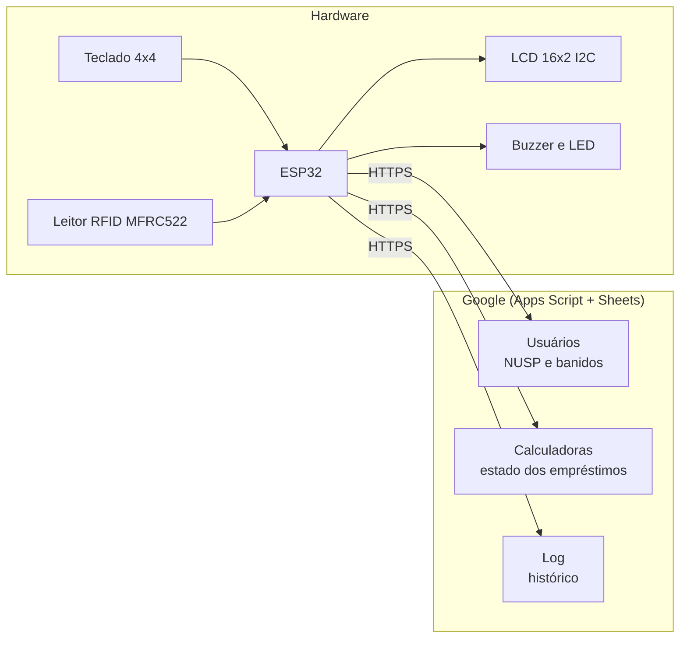
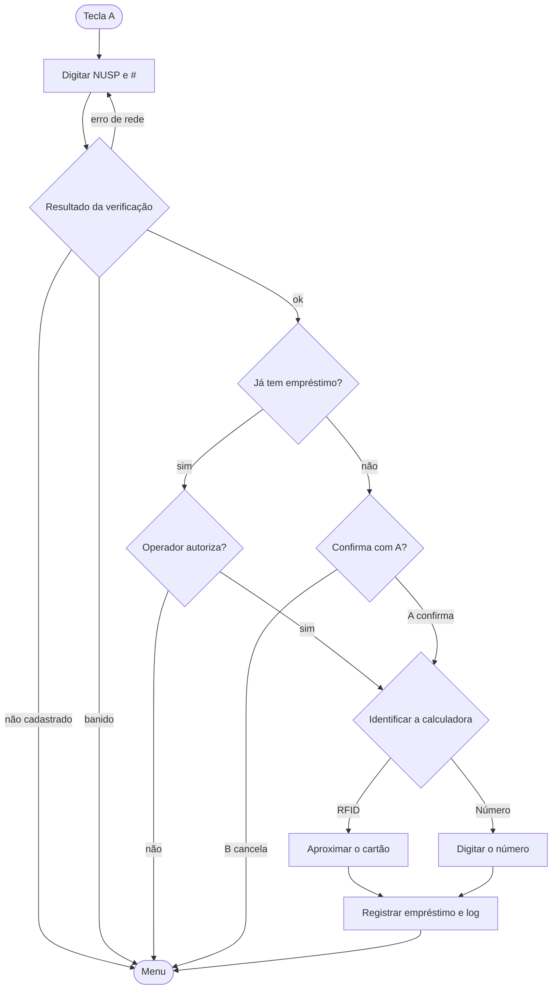

# 🧮 Banco de Calculadoras Automático

**Empréstimo e devolução de calculadoras com ESP32, RFID e Google Sheets.**

---

## 📖 Visão geral

Sistema embarcado que automatiza o empréstimo e a devolução de calculadoras. O operador usa um teclado numérico, um display LCD e um leitor RFID; o ESP32 valida o usuário na nuvem e registra cada operação em planilhas do Google, que funcionam como banco de dados e painel de controle.

## ✨ Funcionalidades

- **Empréstimo** com validação do NUSP: confere se o usuário está cadastrado e se não está banido.
- **Controle de empréstimo ativo:** avisa quando o usuário já tem uma calculadora e deixa o operador decidir se continua.
- **Devolução** por leitura do cartão RFID ou pelo número da calculadora (para etiquetas com defeito).
- **Cadastro de calculadoras** associando o UID do cartão RFID ao número.
- **Entrada de dados flexível:** NUSP de até 10 dígitos, confirmação com `#` e correção com `C`.
- **Cancelamento global:** `*` volta ao menu a qualquer momento.
- **Feedback ao operador:** mensagens no LCD, LED de status e sons distintos no buzzer (tecla, leitura do cartão, sucesso e erro).
- **Duas redes Wi-Fi configuráveis:** a rede é escolhida na inicialização.

## 🎮 Como usar

Ao ligar, o aparelho pede a rede Wi-Fi (`A` para a rede 1, `B` para a rede 2) e, depois de conectado, mostra o menu.

| Tecla | Função |
| :---: | --- |
| `A` | Empréstimo |
| `B` | Devolução |
| `D` | Cadastro de calculadora |
| `C` | Apagar o último dígito |
| `#` | Confirmar |
| `*` | Cancelar e voltar ao menu |

### Empréstimo

### Devolução

Tecla `B`, depois `A` para aproximar o cartão RFID ou `B` para digitar o número da calculadora.

### Cadastro de calculadora

Tecla `D`, depois `A` para ler o cartão e digitar o número que ele representa, ou `B` para registrar só o número (sem cartão).

### Mensagens do LCD

| Mensagem | Significado |
| --- | --- |
| `Erro de rede / tente de novo` | Não houve resposta do servidor depois das tentativas. O NUSP digitado continua na tela: basta apertar `#` de novo. |
| `NUSP nao cadastrado` | O servidor respondeu que o NUSP não existe. |
| `USUARIO BANIDO` | O NUSP consta como banido. |
| `NUSP COM EMPRESTIMO` | O usuário já tem uma calculadora emprestada. |
| `Calculadora nao registrada` | O cartão lido não está associado a nenhuma calculadora. |

## 🛡️ Robustez de rede

Pensado para redes instáveis (como a de um campus):

- Separa **falha de comunicação** ("Erro de rede") de **resposta negativa** ("NUSP nao cadastrado"), em vez de tratar tudo como erro.
- Só aceita resposta HTTP 200 e registra na Serial o código, o motivo da falha e o tempo de cada requisição.
- Faz até **3 tentativas** com espera crescente entre elas, e mostra o andamento no LCD.
- O log recebe um **ID de requisição** (`rid`) por chamada, e o script ignora repetições, então repetir um pedido depois de uma resposta perdida não duplica linhas.
- Se o empréstimo ou a devolução for registrado com sucesso mas o log falhar, a operação conta como concluída (a falha do log aparece na Serial).

## 🔧 Hardware

| Componente | Observação |
| --- | --- |
| ESP32 | Placa de desenvolvimento |
| Leitor RFID MFRC522 | Com cartões/tags |
| Display LCD 16x2 I2C | Endereço `0x27` |
| Teclado matricial 4x4 | |
| Buzzer | |
| LED de status | LED da própria placa (GPIO 2) |

### Pinagem

| Função | Pino (GPIO) |
| --- | :---: |
| RFID SS | 15 |
| RFID RST | 5 |
| LED | 2 |
| Buzzer | 4 |
| Teclado, linhas | 13, 12, 14, 27 |
| Teclado, colunas | 26, 25, 33, 32 |

O leitor RFID usa o SPI padrão do ESP32 (SCK 18, MISO 19, MOSI 23) e o LCD usa o I2C padrão (SDA 21, SCL 22).

## ☁️ Backend (Google Apps Script)

São três scripts, cada um ligado a uma planilha. O ESP32 os chama por requisições `GET` e interpreta a resposta em texto.

| Script | Planilha | Função |
| --- | --- | --- |
| **Usuários** | Cadastros | Recebe o NUSP e responde `OK:<primeiro nome>` ou `ERRO:<motivo>`. O firmware também reconhece `BANIDO:<nome>`. |
| **Calculadoras** | Estado dos empréstimos | Consulta e atualiza o status de cada calculadora (ações abaixo). |
| **Log** | Histórico | Grava cada empréstimo e devolução com data e hora. Deduplica por `rid` e, se um empréstimo é registrado sobre outro sem devolução, gera uma devolução automática marcada "VERIFICAR DEVOLUÇÃO". |

### Ações do script de calculadoras

| Ação | Parâmetros | Resposta |
| --- | --- | --- |
| `consulta_uid` | `uid` | Número da calculadora ou `Calculadora nao registrada` |
| `registro_uid` | `uid`, `num` | `1` registrada, `2` já existia |
| `registro_num` | `num` | `1` registrada, `2` já existia |
| `consulta_emprestimo` | `nusp` | `EMPRESTADO` ou `DISPONIVEL` |
| `registro_emprestimo` | `nusp`, `numero` | `Calculadora emprestada` ou `Calculadora nao encontrada` |
| `registro_devolucao` | `numero` | `Calculadora devolvida` ou `Calculadora nao encontrada` |

### Formato das planilhas

- **Calculadoras:** A número · B UID do cartão · C status · D NUSP · E data · F hora
- **Usuários:** C nome · D NUSP (linha 1 é cabeçalho)
- **Log:** A data · B hora · C ação · D valor · E número da calculadora

## 🚀 Instalação

1. **Planilhas e scripts.** Crie as três planilhas e, em cada uma, um projeto do Apps Script com o código correspondente.
2. **Implantação.** Implante cada script como *Aplicativo da Web* (executar como você; acesso para qualquer pessoa) e guarde a URL terminada em `/exec`.
3. **Bibliotecas.** Na Arduino IDE, instale a plataforma ESP32 e as bibliotecas `Keypad`, `LiquidCrystal_I2C` e `MFRC522`. `HTTPClient`, `WiFi`, `WiFiClientSecure`, `SPI` e `Wire` já vêm com o core do ESP32.
4. **Configuração.** Preencha, no topo do `banco_de_calculadoras.ino`, as duas redes Wi-Fi e as URLs dos três scripts.
5. **Gravação.** Selecione a placa ESP32, compile e envie.

> ⚠️ **Não publique as URLs dos scripts nem as senhas do Wi-Fi.** A URL `/exec` funciona como credencial de acesso às planilhas. Mantenha esses valores fora do repositório.

> 💡 **Atualizando um script:** depois de editar o código, crie uma **nova versão da implantação existente**. Salvar no editor não muda o que a URL `/exec` executa, e criar uma implantação nova gera outra URL.

## 🙏 Créditos

Baseado em [RodrigoLopes1/Banco-de-Calculadoras-Automatico](https://github.com/RodrigoLopes1/Banco-de-Calculadoras-Automatico).

## 📄 Licença

Veja o arquivo [LICENSE](LICENSE).
